<h1 align="center">kolejki-nfz-mcp 🏥</h1>

<p align="center">
  <b>Gdzie najszybciej do specjalisty na NFZ – dla Twojego asystenta AI.</b><br>
  Serwer <a href="https://modelcontextprotocol.io">MCP</a> z oficjalnymi danymi NFZ o kolejkach: prognozowany czas oczekiwania, liczba oczekujących, adres, telefon, odległość i dostępność poradni. Działa w Claude, ChatGPT, Cursorze i każdym kliencie MCP.
</p>

<p align="center">
  <a href="https://www.npmjs.com/package/kolejki-nfz-mcp"></a>
  <a href="https://github.com/ContentWriterco/kolejki-nfz-mcp/actions/workflows/ci.yml"></a>
  <a href="LICENSE"></a>
  
</p>

<p align="center">
  
</p>
<p align="center"><sub>Prawdziwa odpowiedź publicznego serwera (dane NFZ, stan na 10.10.2026).</sub></p>

## Podłącz w 30 sekund

Adres MCP: **`https://kolejki.compabase.com/mcp`** (Streamable HTTP, bez logowania).

- **Claude:** Ustawienia → Connectors → *Add custom connector* → wklej adres.
- **ChatGPT:** Settings → Connectors (tryb deweloperski) → dodaj serwer MCP.
- **Claude Code:** `claude mcp add --transport http kolejki-nfz https://kolejki.compabase.com/mcp`
- **Lokalnie (stdio):** `npx -y kolejki-nfz-mcp`, np. w Claude Desktop:

```json
{ "mcpServers": { "kolejki-nfz": { "command": "npx", "args": ["-y", "kolejki-nfz-mcp"] } } }
```

## Co potrafi

| Narzędzie | Do czego |
|---|---|
| `find_care` | Dla specjalności, badania albo zabiegu (zwykłymi słowami: „okulista”, „ortopeda”, „rezonans magnetyczny”, „zaćma”, „endoprotezoplastyka biodra”) i miejsca (miejscowość, adres, „lat,lon”): poradnie i szpitale z umową z NFZ w okolicy, posortowane według **prognozowanego czasu oczekiwania** NFZ (albo odległości), z **liczbą oczekujących**, średnim czasem czekania, **adresem, telefonem, odległością**, udogodnieniami (winda, podjazd, parking…) i informacją, czy **przyjmują dzieci**. Przypadek stabilny albo **pilny**; poradnia albo oddział szpitalny. |
| `find_benefits` | Oficjalne nazwy świadczeń NFZ pasujące do słowa – gdy trzeba wskazać dokładne świadczenie. |
| `data_sources` | Źródła i zastrzeżenia. |

**Przykładowe pytania:** „Gdzie najszybciej do endokrynologa na NFZ koło Lublina?”, „Rezonans magnetyczny na NFZ w Gdańsku – gdzie najkrótsza kolejka?”, „Ortopeda dla dziecka w Krakowie, najbliżej Nowej Huty”, „Mam skierowanie pilne do neurologa, mieszkam w Pile – dokąd?”, „Gdzie operacja zaćmy najszybciej w woj. śląskim?”.

## Skąd dane

- **Kolejki:** Narodowy Fundusz Zdrowia – API „Terminy leczenia” 1.4 (`https://apinfz.nfz.gov.pl/app-itl-api-pcus/`): listy oczekujących zgłaszane przez placówki z umową z NFZ, z **prognozowanym czasem uzyskania świadczenia** liczonym przez NFZ. Odpowiedzi trzymamy w pamięci podręcznej (6 h) i odpytujemy API powoli, żeby go nie obciążać.
- **Lokalizacja:** GUGiK (państwowy rejestr adresów i granic gmin). Odległość w linii prostej – w miastach do adresu placówki, w mniejszych miejscowościach do ich centrum.
- **Zastrzeżenia:** prognoza to szacunek NFZ, nie rezerwacja – na wizytę zapisuje się telefonicznie lub osobiście w placówce. Nie wszystkie świadczenia mają listy oczekujących w tym API (np. zwykłe porady kardiologiczne). Szukamy w województwie wskazanego miejsca. Serwer nie jest usługą NFZ i nie udziela porad medycznych; w nagłym przypadku – 112.

## Własny serwer

```bash
npx -y kolejki-nfz-mcp --http --port 3000      # MCP: http://localhost:3000/mcp
npx -y kolejki-nfz-mcp find okulista "Poznań"
npx -y kolejki-nfz-mcp find "rezonans magnetyczny" "Gdańsk, Długa 1" --sort distance
npx -y kolejki-nfz-mcp benefits zaćm
```

Zmienne: `KOLEJKI_CACHE_HOURS`, `KOLEJKI_CACHE_DIR`, `KOLEJKI_RATE_LIMIT`, `KOLEJKI_STATS=1` (anonimowe liczniki pod `/stats`), `KOLEJKI_CONTACT`, `KOLEJKI_PUBLIC_URL`.

## Licencja

Kod: MIT. Dane: Narodowy Fundusz Zdrowia (dane publiczne, API „Terminy leczenia”), GUGiK – dane przetworzone. Projekt niezależny, niezwiązany z NFZ, hostowany pro publico bono przez [Compabase](https://compabase.com). Zobacz też [leki-mcp](https://github.com/ContentWriterco/leki-mcp), [powietrze-mcp](https://github.com/ContentWriterco/powietrze-mcp), [szkoly-mcp](https://github.com/ContentWriterco/szkoly-mcp), [rozklad-mcp](https://github.com/ContentWriterco/rozklad-mcp) i [ceny-nieruchomosci-mcp](https://github.com/ContentWriterco/ceny-nieruchomosci-mcp).

---

## English

<p align="center"></p>

**kolejki-nfz-mcp** gives AI assistants **NFZ waiting times in Poland**: for a specialist visit, diagnostic test or procedure (in everyday Polish words) near a place, it lists clinics and hospitals with an NFZ contract sorted by **NFZ's forecast waiting time**, with the number of people waiting, address, phone, distance, accessibility and whether children are seen. Stable or urgent cases. Data: NFZ "Terminy leczenia" API (public data). Public endpoint: `https://kolejki.compabase.com/mcp` (no key), or run locally with `npx -y kolejki-nfz-mcp`. Not affiliated with NFZ; the forecast is not a booking.
